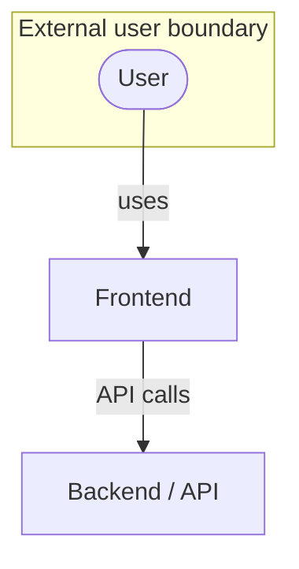
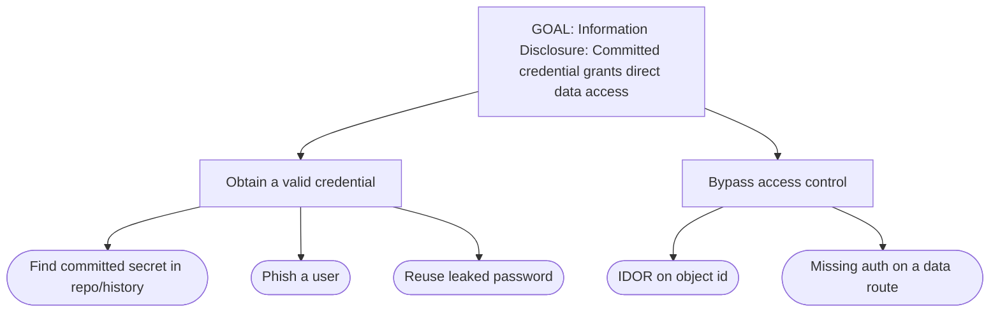
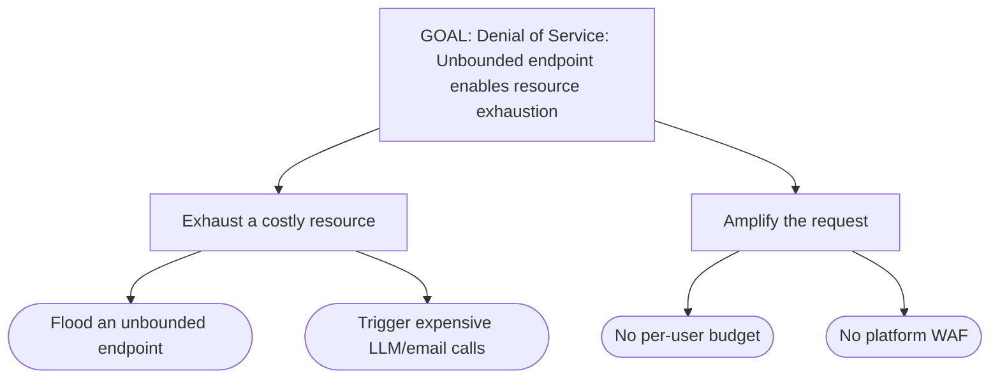
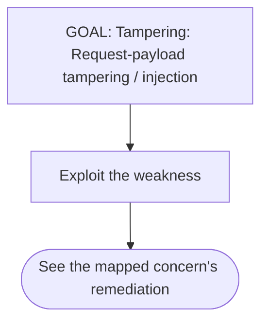

# Threat model — Sanduhr für Claude

> Generated 2026-10-17T04:58:15.533Z

**Tier:** public-facing (OWASP ASVS L2)

## Data-flow diagram

_Convention: stadiums = external entities, rectangles = processes, cylinders = data stores, hexagons = third-parties, subgraphs = trust boundaries._

## Trust boundaries

- **External user boundary**

## Threats by STRIDE category

| Category | Element | Threat | Mitigation | Owner | DREAD |
| --- | --- | --- | --- | --- | --- |
| Spoofing | External user boundary | Credential or session spoofing at the auth boundary | Enforce auth on every state-changing route; harden session tokens (→ auth-model, config CSRF). | config-posture | D:m R:m E:l A:m D:l (8) |
| Tampering | Backend / API process | Request-payload tampering / injection _(realized: rate-058)_ | Validate + parameterize input; pin and verify dependencies (→ owasp-survey, supply-chain). | owasp-survey | D:h R:m E:m A:m D:m (11) |
| Repudiation | Backend / API process | No audit trail on state-changing actions | Add an append-only audit log on auth-state changes and privileged actions (advisory). | advisory | D:l R:m E:l A:l D:l (6) |
| Information Disclosure | Primary datastore | Committed credential grants direct data access _(realized: secret-001)_ | Rotate the credential (step zero), then add .gitignore + scan history (→ secret-detection). | secret-detection | D:h R:h E:h A:h D:h (15) |
| Denial of Service | External user boundary | Unbounded endpoint enables resource exhaustion _(realized: rate-058)_ | Add per-IP / per-user rate limits; platform-native WAF at Public-facing+ (→ rate-limiting). | rate-limiting | D:m R:h E:h A:h D:m (13) |

## Prioritized threats (top 5, DREAD-ordered)

1. **Information Disclosure** — Committed credential grants direct data access (DREAD 15/15, owner: secret-detection)
2. **Denial of Service** — Unbounded endpoint enables resource exhaustion (DREAD 13/15, owner: rate-limiting)
3. **Tampering** — Request-payload tampering / injection (DREAD 11/15, owner: owasp-survey)
4. **Spoofing** — Credential or session spoofing at the auth boundary (DREAD 8/15, owner: config-posture)
5. **Repudiation** — No audit trail on state-changing actions (DREAD 6/15, owner: advisory)

## Attack trees (top 3)

### Attack tree 1

### Attack tree 2

### Attack tree 3

## Continue in a dedicated tool

- **OWASP Threat Dragon** — import the JSON sidecar (`.vibe-sec/state/threat-model.json`) for an interactive GUI and ongoing maintenance.
- **pytm** — for Python-heavy teams wanting threat-model-as-code.

_Vibe Sec generates the initial model from your audit inventory; continue maintaining it in Threat Dragon or pytm if you want._
